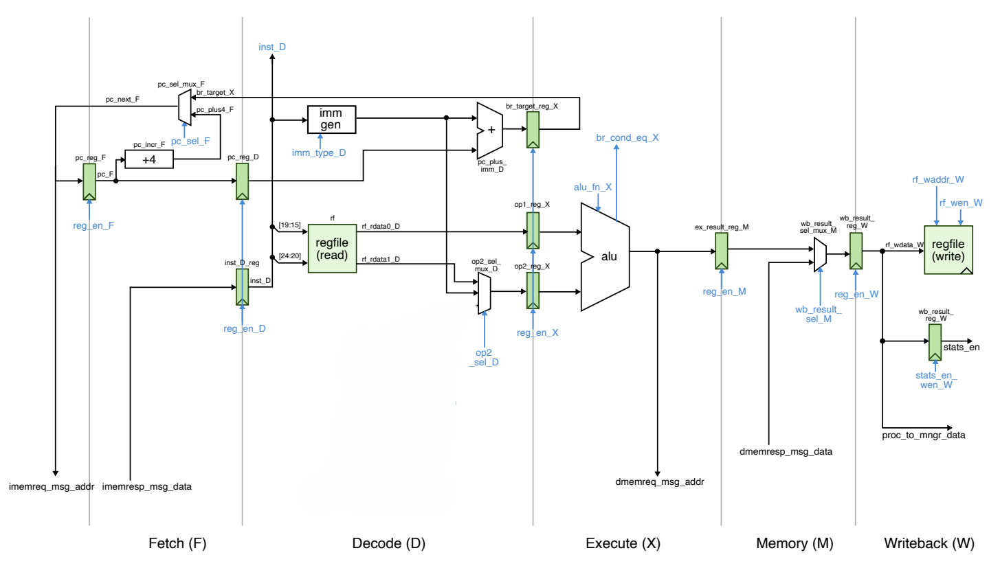

# RV32-MIRA

rv32-mira is a 32-bit, 5-stage pipelined processor based on the RV32I ISA, with dynamic branch prediction. The project was developed to understand microarchitecture and CPU design principles.

Dynamic branch prediction reduces cycle count by up to 24%, and the variable-latency multiplier speeds up matrix multiplication by up to 2.6x.


## Features

- 5-stage pipeline: IF, ID, EX, MEM, WB
- Harvard architecture, 32 KB instruction memory and 32 KB data memory
- Byte-addressable data memory (byte, halfword, word access)
- 37 of the 40 RV32I instructions (`FENCE`, `ECALL`, `EBREAK` not implemented), plus `mul`
- Data forwarding and load-use stall
- 2-bit dynamic branch predictor with a 256-entry BTB
- Variable-latency iterative multiplier with valid/ready handshake
- LUTRAM for the BTB, block RAM for instruction and data memory


## Microarchitecture

<p align="center">
  
</p>

<p align="center">
  <em>(Baseline datapath, before branch predictor and multiplier integration)</em>
</p>

### 1. Hazard Handling

- **Forwarding:** EX operands are bypassed from the MEM and WB stages (MEM has priority). Store data has its own bypass. The register file is write-through.
- **Load-use:** a dependent instruction right after a load stalls IF and ID for one cycle, and a bubble is inserted into EX.
- **Control:** branches and jumps resolve in EX and squash IF and ID.
- **Synchronous instruction memory:** a hold register keeps the fetched instruction when ID stalls. On a flush, the fetched word is masked to zero, which decodes as a no-op.

### 2. Branch Predictor

A direct-mapped Branch Target Buffer with 256 entries, indexed by `PC[9:2]`. Each entry holds a valid bit, a 22-bit tag (`PC[31:10]`), the 32-bit target, and a 2-bit saturating counter.

- The BTB is read in IF, so a predicted-taken branch redirects the PC in the same cycle.
- The outcome is checked in EX. A wrong direction or target squashes IF and ID, a 2-cycle penalty.
- `JAL` and `JALR` are not predicted and always take the 2-cycle redirect.

The baseline is a static predict-not-taken front end. Both versions run the same program in `tb/tb_bench_bp.v`, which also checks that cycles saved equal exactly 2x the mispredictions avoided.

| Benchmark | Branches | Accuracy (off → on) | CPI (off → on) | Cycles (off → on) | Speedup |
| :--- | ---: | :---: | :---: | :---: | ---: |
| `bp_sieve` | 12,672 | 28.76% → 94.08% | 1.45 → 1.10 | 68,541 → 51,987 | 24.15% |
| `bp_bubblesort` | 32,766 | 24.03% → 83.50% | 1.68 → 1.28 | 163,322 → 124,350 | 23.86% |
| `bp_binsearch` | 21,506 | 50.01% → 71.20% | 1.45 → 1.35 | 131,076 → 121,960 | 6.95% |

`bp_binsearch` is limited by its search-direction branch, which is effectively random for a local 2-bit predictor.

### 3. Iterative Multiplier

The multiplier was designed in a previous project and integrated into EX over a valid/ready handshake. The pipeline stalls while a multiplication is in progress.

It is a signed shift-and-add unit. Instead of consuming one multiplier bit per cycle, it skips runs of zeros and stops once the remaining bits are zero, so latency depends on the multiplier operand. Fixed-latency baseline: 34 cycles per mul.

For the design details, see [imul repository](https://github.com/HATRON007/variable-latency-iterative-multiplier).

Benchmark: 16x16 matrix multiplication (4,096 `mul`), with the multiplier operand width varied.

| Width | Cycles (fixed → variable) | CPI (fixed → variable) | Cycles per `mul` | Speedup |
| :---: | :---: | :---: | :---: | :---: |
| 8-bit | 174,485 → 67,413 | 5.71 → 2.21 | 34.00 → 7.86 | 2.59x |
| 16-bit | 174,485 → 91,157 | 5.71 → 2.98 | 34.00 → 13.66 | 1.91x |
| 32-bit | 174,485 → 137,349 | 5.71 → 4.49 | 34.00 → 24.93 | 1.27x |


## FPGA Synthesis

Synthesized in Vivado for an Artix-7 (`xc7a200tfbg676-2`) with a 100 MHz clock constraint. Timing was met with +0.309 ns of setup slack, giving a maximum frequency of about 103 MHz.

| Metric | Result |
| :--- | :--- |
| Maximum frequency | ~103 MHz |
| Slice LUTs | 1,973 (1.47%) |
| Slice registers | 683 (0.25%) |
| Block RAM tiles | 16 (4.38%) |

The two 32 KB memories use the block RAM. The BTB is inferred as distributed RAM.


## Development Approach

The processor was built using an incremental development methodology, in five phases. Each phase added one block or feature on top of a working design, so any bug could be traced to the block that was just added.

**1. Baseline datapath**
Started with only three instructions: `add`, `beq` and `lw`. This kept the focus on the core blocks (ALU, immediate generator, register file, pipeline registers) and their wiring. A manual testbench drove the control signals to check that data flowed correctly through all five stages.

**2. Hazard and control logic**
Added a centralized control unit and a hazard unit to handle data and control hazards. This included forwarding paths, load-use stalls, and flushing on taken branches, and it was the most complex phase of the project.

**3. ISA expansion**
Extended decode and execute to the full RV32I user-level instruction set: R-type, I-type, loads and stores of all sizes, `lui`, `auipc`, `jal`, `jalr` and all branches. Extra care went into jumps and stores, since they interact with the hazard logic added in phase 2.

**4. Branch prediction**
Replaced the static predict-not-taken front end with a 2-bit BTB-based predictor. A benchmark testbench that runs two cores side by side, with and without the predictor, was built to measure its effect on cycle count and accuracy.

**5. Multiplier integration**
Integrated the variable-latency iterative multiplier into EX over a valid/ready handshake. The pipeline stalls while a multiplication is in progress and resumes when the result is valid.


## Repository Structure

```text
rtl/
  proc/       pipeline stages, control, hazard unit, BTB, ALU, regfile, memory
  imul/       iterative multiplier
tb/
  tb_isa/     instruction tests
  tb_hz/      forwarding, load-use and flush tests
  tb_imul/    multiplier tests
  tb_bp/      branch predictor test
  tb_bench_bp.v, tb_bench_imul.v    benchmark testbenches
sw/           C benchmarks, startup code, linker script, Makefile (see sw/README.md)
scripts/      run.py (test runner)
docs/         resources
```


## Usage

**Requirements**

- [Icarus Verilog](https://steveicarus.github.io/iverilog/) and Python 3, to run the simulations
- [RISC-V GNU toolchain](https://github.com/riscv-collab/riscv-gnu-toolchain) (`riscv64-unknown-elf-gcc`) and make, to build the benchmarks (Linux or WSL)

**Run**

```bash
git clone https://github.com/HATRON007/rv32-mira.git
cd rv32-mira

python scripts/run.py unit      # directed tests
make -C sw                      # build the benchmark programs (Linux / WSL)
python scripts/run.py bench     # run the benchmarks
```

Tested with the benchmarks built in WSL and the simulations run on Windows with the OSS CAD Suite. Use `python3` instead of `python` on Linux.

Each test prints `[PASS]` or `[FAIL]`, and a run ends with a count such as `3/3 passed`. See [`sw/README.md`](sw/README.md) for how the benchmarks work.
